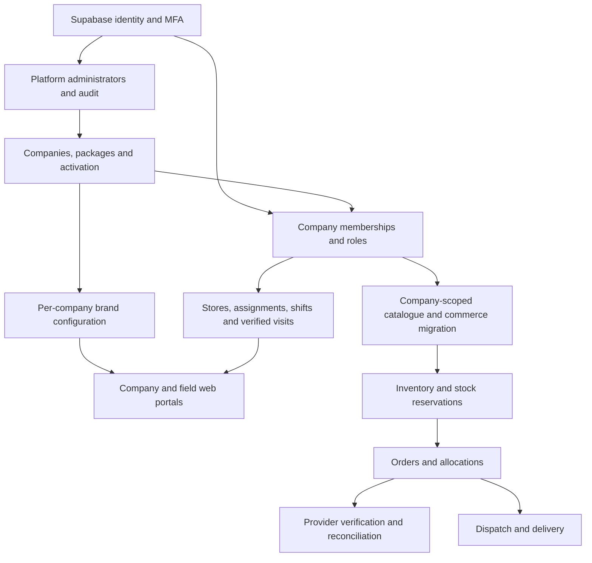

# E-Edge Direct 2U platform implementation

## Repository audit — 14 October 2026

Next.js 16.4 / React 19 / TypeScript form a modular monolith. Supabase provides PostgreSQL, Auth and Storage; Paystack handles payments. Android WebView and Windows WebView2 clients consume the hosted app. iOS native distribution is not implemented.

Preserve the existing transactional checkout, integer-kobo prices, reservation ledger, provider verification, merchant allocations, customer account workflows, Theme Studio history, driver assignments and audited operations. Merchant isolation currently exists inside one business. The existing commerce schema is not a complete company-tenancy model; it must not be advertised or exposed as one.

## Module dependency map

## Application boundaries

- `/` and `/admin`: preserve the operating flagship marketplace and company administration while migrating its commerce domains incrementally.
- `/platform`: separate software-owner control plane; independent administrator grants and verified MFA are required. Tenant admins do not inherit platform access.
- `/company/[slug]`: company-scoped settings, membership and field operations, using database-enforced membership and tenant identifiers.
- `/field/[slug]`: assigned field work; web execution is disabled unless company policy permits it. Starting a visit never counts as completing one.
- Existing `/merchant` and `/driver` remain the flagship commerce workspaces. Native GPS, offline synchronization, signatures/OTP, notifications and iOS releases need distinct implementation and device acceptance.

## Foundation release boundary

Introduce an additive tenant kernel rather than changing previously applied migrations. Each tenant has independent memberships, policies, branding, stores, assignments, shifts and visit records. Foreign keys include the tenant identifier wherever records cross domain boundaries. SQL authorization and RLS are tested with two companies and deliberately hostile requests.

Keep new companies' commerce and delivery provisioning disabled until catalogue, order, inventory, finance, Storage paths, carts and all privileged RPCs are tenant-scoped and tested. Entitlements describe available implementations; a package name must not unlock an unported domain. Never fall back from an unknown company to the flagship's private data.

The flagship uses the supplied official logo with orange, black and white tokens. Existing customer-generated theme content is preserved through an explicit audited branding update. Other companies keep independent brand rows.

## Acceptance and integration boundaries

GPS policy checks validate coordinates, reported accuracy, capture age and radius on the server. Browser coordinates are not proof against a compromised device. Supervisor overrides need a recorded reason, and completion needs submitted task evidence. Default radius: 100 metres; default field target: 30 stores. Web execution is opt-in.

Exact visit coordinates expire after 90 days through `field_purge_location()`; completed task reports and operational audit remain. `node scripts/operations.cjs --schedule` installs the daily database retention job alongside reservation expiry. The browser requests location only after the agent presses check-in; there is no continuous or background tracking in this release. History and schedule views are bounded to prevent unbounded private-data downloads.

The software owner is deliberately not inferred from a company-admin role. Once the owner identity is explicitly chosen, run `node scripts/operations.cjs --platform-owner-email <confirmed-email>` from the trusted deployment machine, then the owner signs in and configures their own authenticator at `/platform/security`. No password, TOTP seed or code belongs in source control. The bootstrap is audited and leaves commerce roles unchanged.

Company branding changes and the existing flagship Theme Studio synchronize transactionally. Other companies never write the flagship settings. Migration 010 applies the supplied official brand and retains the previous theme for rollback; existing products, orders and customer-created homepage content are preserved.

Paystack is shared with Nexzek; preserve its current webhook until shared routing is commissioned. Supabase control-plane account recovery, business SMTP, maps/routing, push providers, native offline/location execution and Apple signing remain external commissioning requirements. Do not label these integrations working without acceptance evidence.
